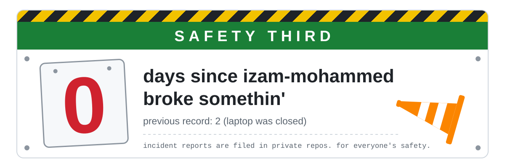

  <picture>
    <source media="(prefers-color-scheme: dark)" srcset="assets/banner-dark.svg">
    <source media="(prefers-color-scheme: light)" srcset="assets/banner-light.svg">
    
  </picture>

Just me ~ tryin' things, breakin' things, and hidin' the embarrassing parts in private repos.

somethin' more @ [this page*](https://izam-mohammed.github.io/)
